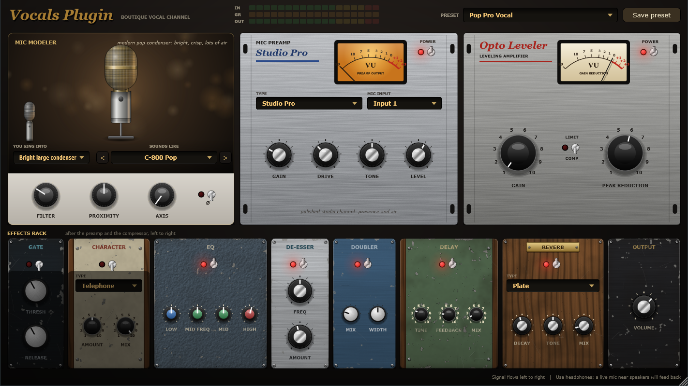
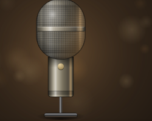
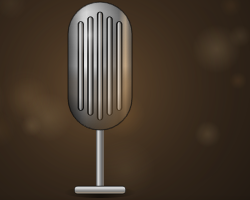
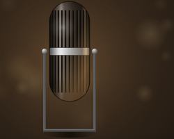
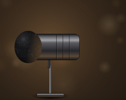
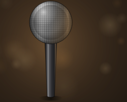
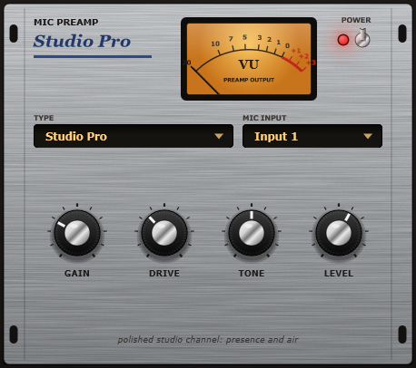
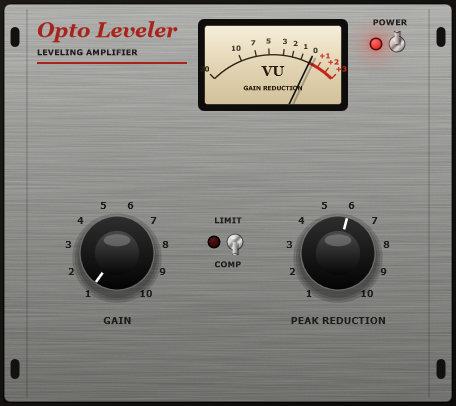
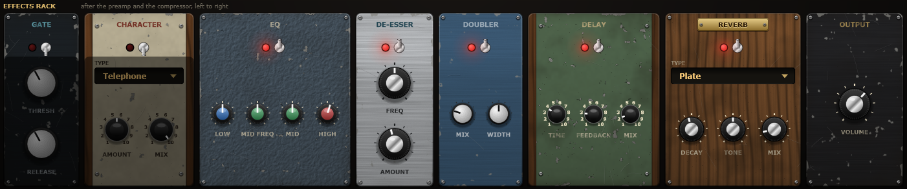

<p align="center">
  
</p>

<h1 align="center">Vocals Plugin</h1>

<p align="center">
  <b>A vocal studio channel for Windows: sing into your mic, hear it through a classic one.</b><br>
  Mic modeler · 7 preamps · optical leveler · 8 effects · 17 presets — VST3 plugin + standalone app · free to use
</p>

<p align="center">
  <a href="https://ale-studios.github.io/VocalsPlugin/"><b>Website</b></a> ·
  <a href="../../releases/latest"><b>Download</b></a> ·
  <a href="MANUAL.md">Manual</a> ·
  <a href="LICENSE.md">License</a>
</p>

---

Vocals Plugin puts a whole vocal chain in one window, laid out like a rack in a studio:

```
your mic  →  mic modeler  →  preamp  →  opto leveler  →  gate · character · EQ · de-esser · doubler · delay · reverb  →  out
```

Tell it which kind of microphone you're singing into, pick the one you want to sound like,
choose a preamp and a preset. The differences are meant to be heard, not guessed.

## The mic modeler

First Vocals Plugin takes away the colour of your own microphone, then adds the colour of
the model you picked. It also models how a voice changes when you get close to a mic
(**proximity**) and when you sing off to the side (**axis**).

| | |
|---|---|
| **N-87 Studio** | the studio standard: smooth, open, a touch of presence |
| **N-47 Tube** | big tube condenser: thick low-mids, warm rounded top |
| **T-251 Tube** | silky tube condenser: airy, sweet and detailed |
| **C-800 Pop** | modern pop condenser: bright, crisp, lots of air |
| **D-7 Broadcast** | broadcast dynamic: dark, smooth, close and intimate |
| **D-58 Stage** | the stage dynamic: mid forward, bright bite, light bass |
| **V-55 Fifties** | fifties chrome dynamic: narrow, honky, rock'n'roll |
| **R-44 Ribbon** | vintage ribbon: dark, velvety, big and round |

<p align="center">
  
  
  
  
  
  
  
  
</p>

## Preamp and leveler

**Mic Preamp**: seven characters, from transparent to fully distorted, with a VU meter that follows
the preamp's output. Clean · Studio Pro · Vintage Tube · British Console · Vintage Blues · Rough · Distortion.

**Opto Leveler**: an optical-style compressor with two knobs, GAIN and PEAK REDUCTION, and a
COMP / LIMIT switch. Its release slows down when it has been working hard, so long phrases stay even
without pumping.

<table>
<tr>
<td width="50%"></td>
<td width="50%"></td>
</tr>
</table>

## The effects rack

Each effect has its own hardware look: anodised metal, painted steel, oak and walnut, some brand new
and some well used.

<p align="center"></p>

**Gate** · **Character** (Telephone, Old Radio, Megaphone, Lo-Fi) · **EQ** · **De-esser** ·
**Doubler** (two slightly detuned copies spread left and right) · **Delay** · **Reverb** (Hall, Plate, Room) · **Output**

## 17 presets

Init (natural) · Pop Pro Vocal · Memphis '56 Slapback · Golden Tube Ballad · Silky Studio Air ·
Classic Studio 87 · Late Night Radio Host · Live Stage Rock · Velvet Crooner · Vintage Blues Shouter ·
Telephone Verse · Old Radio Broadcast · Megaphone · Rough & Raspy · Distortion Scream · Lo-Fi Bedroom ·
Cathedral Hall

All presets are set to the same loudness, so when you switch between them you hear a different sound,
not just a louder one. You can save your own vocal chains next to them.

## Download & install

1. Download **`VocalsPlugin-1.0.0-Setup.exe`** from [Releases](../../releases/latest) and run it.
   Choose the standalone app, the VST3 plugin or both. The plugin goes into the standard VST3 folder,
   `C:\Program Files\Common Files\VST3`, where every DAW looks.
2. **Standalone:** open **Vocals Plugin** from the Start menu, then **Options → Audio/MIDI Settings**,
   and choose your audio interface's input and output. Your mic starts **muted** to prevent feedback:
   put on headphones, then untick **Mute audio input** in the same window.
3. **Plugin:** rescan plugins in your DAW and put Vocals Plugin on a vocal track.

To remove it, use **Settings → Apps** in Windows. Your saved presets stay in `Documents\Vocals Plugin Presets`.

> Windows may show *"Windows protected your PC"* the first time, because the app isn't code-signed.
> Click **More info → Run anyway**.

**Requirements:** Windows 10 / 11 (64-bit), a microphone and an audio interface, plus any VST3 host
for the plugin. If your mic is a condenser, it needs phantom power (48V) from your interface.

**Use headphones.** An open microphone near speakers will feed back.

**Low latency:** in the standalone app choose **Windows Audio (Low Latency Mode)** and the
smallest buffer that plays without crackles. Inside a DAW, the plugin uses the DAW's own driver
(ASIO included) and adds only 3 samples of latency.

## Privacy

Vocals Plugin works fully offline, with no account, no telemetry and no network access. It only writes its own
settings and the presets you save (`Documents\Vocals Plugin Presets`).

## Good to know

- The mic models, preamps and effects are original simulations, tuned by ear from public descriptions
  of classic studio gear. They are meant to get you close to a sound, not to clone a specific
  microphone or recording.
- Model and preset names are original; see [NOTICES.md](NOTICES.md).

## License

Free to use, not open source. See [LICENSE.md](LICENSE.md).
